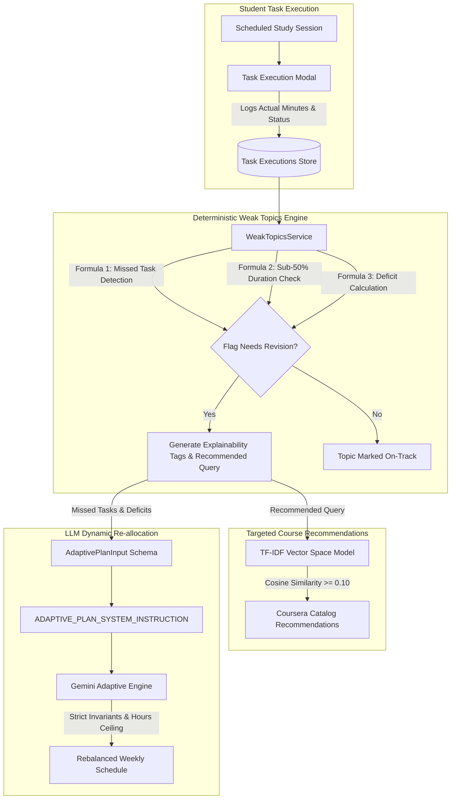
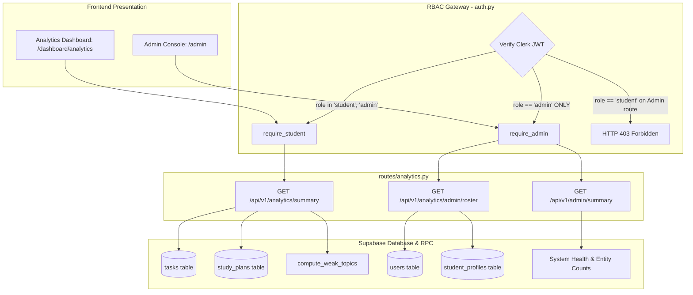
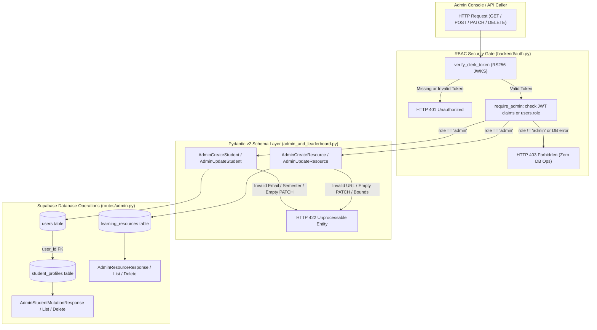
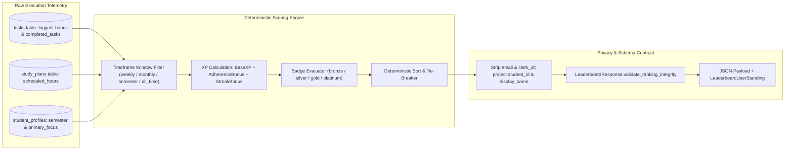

# System Architecture & Technical Specification
## Deterministic Diagnostic Engine & Adaptive Study Plan Re-balancing

---

### 1. Architectural Overview & Design Philosophy

The **Smart Learning Planner** operates on a hybrid architecture designed to maintain high educational reliability and zero hallucinations:
1. **Generative AI (Google Gemini 1.5/2.0 Flash)** is utilized exclusively where natural language synthesis, schedule contextualization, and semantic topic planning add high value.
2. **Deterministic Diagnostic Rules** are strictly employed for assessing student deficiencies and academic mastery. **No probabilistic AI claims or speculative hallucinations are permitted** when deciding whether a student is weak in a subject.
3. **Information Retrieval (TF-IDF & Cosine Similarity)** grounds all learning resource recommendations in verified course catalogs (Coursera).

This document details the mathematical formulations governing **Weak Topic Detection** and the strict schema specifications powering **Adaptive Plan Re-allocation**.



---

### 2. Deterministic Weak Topic Detection Engine

The diagnostic engine is implemented in [backend/services/weak_topics.py](file:///e:/FinalYear/backend/services/weak_topics.py). It processes the active study plan and task execution telemetry without making external LLM calls.

#### 2.1 Mathematical Definitions & Variables
For any study session $s \in S$ belonging to topic $T$ of subject $Sub$:
- $P(s) \in \mathbb{R}^+$: Planned study duration in minutes ($P(s) = \text{duration\_hours} \times 60$).
- $A(s) \in \mathbb{R}_{\ge 0}$: Actual study minutes logged by the student.
- $\text{status}(s) \in \{\text{'completed'}, \text{'partially\_completed'}, \text{'missed'}, \text{'in\_progress'}, \text{None}\}$: Task execution status.
- $\text{day\_idx}(s) \in \{1, 2, \dots, 7\}$: Scheduled day index (Monday = 1, Sunday = 7).
- $\text{current\_day\_idx} \in \{1, 2, \dots, 7\}$: Active reference day index.

For topic $T$ across all evaluated sessions $S_T$:
$$\text{PlannedMinutes}(T) = \sum_{s \in S_T} P(s)$$
$$\text{ActualMinutes}(T) = \sum_{s \in S_T} A(s)$$
$$\text{Deficit}(T) = \max\Big(0, \text{PlannedMinutes}(T) - \text{ActualMinutes}(T)\Big)$$
$$\text{DurationRatio}(T) = \frac{\text{ActualMinutes}(T)}{\max(1, \text{PlannedMinutes}(T))}$$

---

#### 2.2 Deterministic Decision Rules

A topic $T$ is flagged with `status = "Needs Revision"` if and only if one or more of the following deterministic conditions are satisfied:

##### Rule 1: Explicitly Missed Sessions Criterion
A session $s$ is evaluated as missed if:
$$\text{is\_missed}(s) = \begin{cases} 
\text{True}, & \text{if } \text{status}(s) = \text{'missed'} \\
\text{True}, & \text{if } \text{day\_idx}(s) < \text{current\_day\_idx} \land s \notin \text{completed\_ids} \land \text{status}(s) \notin \{\text{'completed'}, \text{'rebalanced'}\} \\
\text{False}, & \text{otherwise}
\end{cases}$$

If $\sum_{s \in S_T} \mathbb{I}(\text{is\_missed}(s)) > 0$:
- **Status**: `"Needs Revision"`
- **Severity**: `"high"`
- **Deterministic Tag**: `"Missed Task: {topic}"` (and `"{count} Missed Sessions"` if count $> 1$)

##### Rule 2: Sub-50% Study Duration Criterion
A session $s$ exhibits a sub-50% duration deficit if:
$$\text{is\_sub50}(s) = \left( \frac{A(s)}{P(s)} < 0.50 \right) \land \Big( P(s) - A(s) \ge 15\text{ mins} \Big)$$

If any session has $\text{is\_sub50}(s) = \text{True}$ or the topic aggregate $\text{DurationRatio}(T) < 0.50$:
- **Status**: `"Needs Revision"`
- **Deterministic Tag**: `"Sub-50% Study Duration ({int}(\text{DurationRatio} \times 100)\%)"`
- **Severity**: Elevated to at least `"medium"` (or `"high"` if deficit $\ge 60$ mins).

##### Rule 3: Quantifiable Deficit Thresholding
$$\text{Severity}(T) = \begin{cases}
\text{"high"}, & \text{if } \text{Deficit}(T) \ge 60\text{ mins} \lor \text{missed\_sessions} > 0 \\
\text{"medium"}, & \text{if } 15\text{ mins} \le \text{Deficit}(T) < 60\text{ mins} \lor \text{DurationRatio}(T) < 0.50 \\
\text{"low"}, & \text{otherwise}
\end{cases}$$

If $\text{Deficit}(T) \ge 15\text{ mins}$:
- **Deterministic Tag**: `"Study Deficit: -{\text{Deficit}(T)}m"`

##### Rule 4: Multi-Session Low Completion Rate
For topics with multiple planned sessions $|S_T| \ge 1$:
$$C(T) = \frac{\sum_{s \in S_T} \mathbb{I}(\text{is\_done}(s))}{|S_T|} \times 100$$
If $C(T) < 50\%$ and $\sum \mathbb{I}(\text{is\_done}(s)) < |S_T|$:
- **Deterministic Tag**: `"Completion Rate: {C(T)}\% (Low Mastery)"`

##### Rule 5: High Priority Exam Target Alignment
If $\exists s \in S_T$ such that $\text{priority}(s) = \text{"high"}$ and topic $T$ is flagged as `"Needs Revision"`:
- **Deterministic Tag**: `"High Priority Exam Target"`

##### Rule 6: Protection for Future Unattempted Sessions
To prevent false-positive deficits:
$$\forall s \in S : \Big(\text{day\_idx}(s) > \text{current\_day\_idx} \land \text{has\_no\_telemetry}(s)\Big) \implies \text{ignored from evaluation}$$

---

#### 2.3 Deterministic Priority Sorting
Flagged weak topics are sorted deterministically before delivery to the frontend or recommendation pipeline:
$$\text{Rank}(T) = \Big( \mathbb{I}(\text{missed\_sessions} > 0), \; \text{SeverityRank}(T), \; \text{Deficit}(T) \Big) \quad \text{descending}$$
where $\text{SeverityRank}(\text{'high'}) = 3, \; \text{SeverityRank}(\text{'medium'}) = 2, \; \text{SeverityRank}(\text{'low'}) = 1$.

---

### 3. Adaptive Prompt Schema & Dynamic Re-Allocation

When the user requests an adaptive re-balance or the system detects missed high-priority tasks, [backend/prompts/study_plan.py](file:///e:/FinalYear/backend/prompts/study_plan.py) constructs an adaptive prompt grounded in strict Pydantic schemas.

#### 3.1 Pydantic Input Schemas

##### `MissedTaskInput`
Defines an individual missed task with required deficit quantification:
```python
class MissedTaskInput(BaseModel):
    task_id: Optional[str] = Field(None, description="Unique identifier of the missed task")
    subject: str = Field(..., description="Subject name (exact string)")
    topic: str = Field(..., description="Topic name")
    priority: PriorityLevel = Field("high", description="Session priority ('high', 'medium', 'low')")
    missed_day: DayName = Field(..., description="Day on which session was scheduled and missed")
    planned_duration_hours: float = Field(..., ge=0.1, description="Original planned duration in hours")
    actual_minutes_studied: float = Field(0.0, ge=0.0, description="Actual minutes studied before dropping")
    deficit_hours: float = Field(..., ge=0.0, description="Net remaining hours needed to recover topic")
    reason: Optional[str] = Field("Missed study session", description="Audit reason for deficit")
```

##### `AdaptivePlanInput`
Defines the full payload provided to the adaptive AI planner:
```python
class AdaptivePlanInput(BaseModel):
    current_plan: StudyPlanOutputSchema = Field(
        ...,
        description="The active 7-day study plan to be dynamically rebalanced"
    )
    missed_tasks: List[MissedTaskInput] = Field(
        ...,
        description="List of missed study sessions, focusing on high-priority subjects"
    )
    current_day: DayName = Field(
        ...,
        description="Active day of the week. Re-allocation only targets this day and subsequent days."
    )
    daily_hours_limit: Optional[float] = Field(
        None,
        ge=0.5,
        le=16.0,
        description="Maximum available study hours per day to enforce non-overload invariant"
    )
    onboarding_data: Optional[OnboardingDataInput] = Field(
        None,
        description="Original student profile constraints"
    )
    adaptation_goal: Optional[str] = Field(
        "Dynamically re-allocate missed high-priority subjects into remaining days without exceeding daily study hours"
    )
```

---

#### 3.2 System Prompt Invariants (`ADAPTIVE_PLAN_SYSTEM_INSTRUCTION`)

The system prompt strictly binds Gemini to ten non-negotiable operational invariants:

| # | Invariant Rule | Operational Enforcement |
| :-: | :--- | :--- |
| **1** | **Mandatory High-Priority Recovery** | All missed tasks with `priority="high"` must be rescheduled into remaining days with `core_concept_study` or `practice_problems` and prefixed with `"Catch-up: "`. |
| **2** | **Forward-Only Allocation** | Rescheduling is strictly restricted to days $d \ge \text{current\_day}$. Historical days ($d < \text{current\_day}$) must remain unchanged. |
| **3** | **Strict Daily Hours Ceiling** | $\forall d : \sum_{s \in d} \text{duration\_hours}(s) \le \text{daily\_hours\_limit}$. If adding sessions causes overflow, the LLM must compress or defer `low` priority sessions. |
| **4** | **Cognitive Load Balancing** | No single day may contain $> 2.0$ consecutive hours of the same intensive technical subject. Catch-up work must be spread across days with lowest existing load. |
| **5** | **Zero-Hallucination Subject Fidelity** | Subject names must preserve 100% exact character strings from input profiles (e.g. `'BI-402'`, `'C++'`, `'AI/ML'`). |
| **6** | **Chronological Conflict-Free Timings** | Days must follow Monday $\to$ Sunday sequence. Within days, sessions must have valid, non-overlapping 24h `start_time` and `end_time` blocks. |
| **7** | **Optimized Search Keywords** | Output `search_keywords` array must be updated to include missed high-priority subjects + core skills to feed the TF-IDF Coursera recommendation service. |
| **8** | **Transparent Strategy Summary** | `strategy_summary` in `plan_overview` must explain exact reallocation actions and compression decisions. |
| **9** | **Strict Schema Compliance** | Output must adhere directly to `StudyPlanOutputSchema` without markdown wrappers. |
| **10** | **Recalculated Aggregates** | Day `total_hours` and weekly `weekly_total_hours` must match exact sums of active sessions. |

---

### 4. Integration with Targeted Recommendations

When [WeakTopicsService](file:///e:/FinalYear/backend/services/weak_topics.py) flags a weak topic, it automatically produces a normalized search query string:
$$\text{recommended\_query} = \text{Subject} \oplus \text{" "} \oplus \text{Topic}$$

This string is fed into [RecommendationService](file:///e:/FinalYear/backend/services/recommendation_service.py):
1. Transformed via fitted unigram `TfidfVectorizer(stop_words='english', max_features=5000)`.
2. Compared via **Cosine Similarity** against 3,522 Coursera course documents.
3. Pruned by cutoff threshold:
   $$\text{Filter: } \text{Sim}(\vec{q}, \vec{d}_i) \ge 0.10$$
4. Top 5 targeted refresher courses are rendered directly in the student's dashboard widget.

---

### 5. Verification Matrix & Test Coverage

The deterministic diagnostic rules, profile updates, and analytics APIs are validated across the repository test suites:

| Component | Test Suite | Pass Rate | Validated Invariants |
| :--- | :--- | :---: | :--- |
| **Weak Topic Rules** | [test_weak_topics.py](file:///e:/FinalYear/backend/tests/test_weak_topics.py) | **6/6 (100%)** | Missed tasks, sub-50% duration threshold, future day protection, deterministic ordering |
| **Adaptive Schemas** | [test_study_plan_prompt.py](file:///e:/FinalYear/backend/tests/test_study_plan_prompt.py) | **30/30 (100%)** | Pydantic validation of `AdaptivePlanInput`, `MissedTaskInput`, prompt construction |
| **AI Anti-Hallucination** | [run_prompt_isolation_tests.py](file:///e:/FinalYear/backend/tests/run_prompt_isolation_tests.py) | **12/12 (100%)** | Subject fidelity across obscure electives, chronological timings, keywords mapping |
| **Full Lifecycle Flow** | [test_e2e_flow.py](file:///e:/FinalYear/backend/tests/test_e2e_flow.py) | **5/5 (100%)** | Plan $\to$ Miss Task $\to$ Deterministic Weak Topic Flag $\to$ Targeted Recs $\to$ Re-balance |
| **Settings Schemas** | [test_settings_schemas.py](file:///e:/FinalYear/backend/tests/test_settings_schemas.py) | **23/23 (100%)** | Input validation on daily hours (0.5–16h), password complexity, goals, and notification models |
| **Profile Hours Update** | [test_profile_update_isolation.py](file:///e:/FinalYear/backend/tests/test_profile_update_isolation.py) | **17/17 (100%)** | Hours reduction detection, overloaded day calculation, adaptive rebalance trigger, FastAPI isolation |
| **RBAC & Analytics** | [test_analytics_and_roles.py](file:///e:/FinalYear/backend/tests/test_analytics_and_roles.py) | **10/10 (100%)** | Role separation (`student` vs `admin`), 403 Forbidden enforcement on admin endpoints, roster retrieval |
| **Analytics E2E** | [test_analytics_settings_e2e.py](file:///e:/FinalYear/backend/tests/test_analytics_settings_e2e.py) | **7/7 (100%)** | Scheduled vs actual hours calculation, subject distribution, weekly performance, diagnostic embedding |
| **Admin & Leaderboard Schemas** | [test_admin_and_leaderboard_schemas.py](file:///e:/FinalYear/backend/tests/test_admin_and_leaderboard_schemas.py) | **10/10 (100%)** | `AdminCreateResource`, `AdminUpdateStudent`, URL/bounds validation, `LeaderboardResponse` rank integrity |
| **Admin RBAC Isolation** | [test_admin_rbac_isolation.py](file:///e:/FinalYear/backend/tests/test_admin_rbac_isolation.py) | **7/7 (49 subtests)** | Real `require_admin` dependency blocks students (403), DB fallback, fail-closed safety, zero DB mutations |

---

### 6. Analytics Aggregation Engine & Telemetry Architecture (Module 8)

The Analytics module ([backend/routes/analytics.py](file:///e:/FinalYear/backend/routes/analytics.py)) provides academic telemetry and velocity metrics for students and instructors. It computes real-time aggregates directly from completed study tasks, scheduled calendar blocks, and the active study plan.



#### 6.1 Telemetry Metrics & Mathematical Formulations

##### 1. Study Velocity & Adherence Rate
For a student with scheduled study tasks $T = \{t_1, t_2, \dots, t_n\}$:
- Planned Duration: $H_{\text{scheduled}}(t) \in \mathbb{R}^+$ parsed from task description or default $1.0\text{h}$.
- Actual Duration: $H_{\text{actual}}(t) = H_{\text{scheduled}}(t)$ if $t$ is marked completed ($\text{is\_completed} = \text{True}$), else $0.0\text{h}$.

$$\text{TotalScheduledHours} = \sum_{t \in T} H_{\text{scheduled}}(t)$$
$$\text{TotalActualHours} = \sum_{t \in T} H_{\text{actual}}(t)$$
$$\text{AdherenceRate} = \begin{cases}
\text{round}\left( \frac{\text{TotalActualHours}}{\text{TotalScheduledHours}} \times 100 \right), & \text{if } \text{TotalScheduledHours} > 0 \\
100\%, & \text{otherwise}
\end{cases}$$

##### 2. Task Completion Rate
$$\text{CompletionPercentage} = \begin{cases}
\text{round}\left( \frac{\sum_{t \in T} \mathbb{I}(\text{is\_completed}(t))}{|T|} \times 100 \right), & \text{if } |T| > 0 \\
100\%, & \text{otherwise}
\end{cases}$$

##### 3. Subject-Level Hours & Mastery Breakdown
Tasks are mapped to subjects by parsing the task title prefix (`title.split(":", 1)[0]`):
- For each unique subject $Sub$:
  - $\text{PlannedHours}(Sub) = \sum_{t \in T_{Sub}} H_{\text{scheduled}}(t)$
  - $\text{ActualHours}(Sub) = \sum_{t \in T_{Sub}} H_{\text{actual}}(t)$
  - $\text{MasteryPercentage}(Sub) = \text{round}\left( \frac{\sum_{t \in T_{Sub}} \mathbb{I}(\text{is\_completed}(t))}{|T_{Sub}|} \times 100 \right)$
  - Visualization palette assigned deterministically from a 7-color token set (`#6366F1`, `#06B6D4`, `#10B981`, `#F59E0B`, `#8B5CF6`, `#EC4899`, `#3B82F6`).

##### 4. Day-by-Day Weekly Performance & Deficits
For each day of the week $d \in \{\text{Mon}, \text{Tue}, \text{Wed}, \text{Thu}, \text{Fri}, \text{Sat}, \text{Sun}\}$:
$$\text{ScheduledHours}(d) = \sum_{t \in T_d} H_{\text{scheduled}}(t)$$
$$\text{ActualHours}(d) = \sum_{t \in T_d} H_{\text{actual}}(t)$$
$$\text{DeficitHours}(d) = \max\Big(0.0, \; \text{ScheduledHours}(d) - \text{ActualHours}(d)\Big)$$
$$\text{DayCompletionPct}(d) = \begin{cases}
\text{round}\left( \frac{\text{ActualHours}(d)}{\text{ScheduledHours}(d)} \times 100 \right), & \text{if } \text{ScheduledHours}(d) > 0 \\
100\%, & \text{otherwise}
\end{cases}$$

##### 5. Diagnostic Weak Topics Embedding
The analytics payload automatically embeds output from `compute_weak_topics(plan_data)`, rendering the student's active Needs Revision badges, explainability tags, and priority ranks directly on the Analytics dashboard.

---

#### 6.2 Analytics Summary API Specification

- **Endpoint**: `GET /api/v1/analytics/summary`
- **Access Level**: Protected via `require_student` (accessible by authenticated `student` or `admin`).
- **Response Structure**:
```json
{
  "success": true,
  "role": "student",
  "overview": {
    "total_scheduled_hours": 32.5,
    "total_actual_hours": 28.0,
    "adherence_rate": 86,
    "completed_tasks_count": 14,
    "total_tasks_count": 16,
    "completion_percentage": 88,
    "missed_tasks_count": 2
  },
  "subject_distribution": [
    {
      "name": "Operating Systems",
      "hours": 12.0,
      "planned_hours": 14.0,
      "mastery": 85,
      "sessions_count": 6,
      "color": "#6366F1"
    },
    {
      "name": "Computer Networks",
      "hours": 9.0,
      "planned_hours": 10.5,
      "mastery": 80,
      "sessions_count": 5,
      "color": "#06B6D4"
    }
  ],
  "weekly_hours": [
    { "day": "Mon", "scheduled": 4.5, "actual": 4.5, "deficit": 0.0, "completion": 100 },
    { "day": "Tue", "scheduled": 5.0, "actual": 3.0, "deficit": 2.0, "completion": 60 },
    { "day": "Wed", "scheduled": 4.5, "actual": 4.5, "deficit": 0.0, "completion": 100 },
    { "day": "Thu", "scheduled": 5.0, "actual": 5.0, "deficit": 0.0, "completion": 100 },
    { "day": "Fri", "scheduled": 4.5, "actual": 4.5, "deficit": 0.0, "completion": 100 },
    { "day": "Sat", "scheduled": 4.5, "actual": 4.5, "deficit": 0.0, "completion": 100 },
    { "day": "Sun", "scheduled": 4.5, "actual": 2.0, "deficit": 2.5, "completion": 44 }
  ],
  "diagnostic_topics": [
    {
      "subject": "Operating Systems",
      "topic": "Process Synchronization",
      "status": "Needs Revision",
      "severity": "high",
      "tags": ["Sub-50% Study Duration (0%)", "Study Deficit: -90m", "High Priority Exam Target"]
    }
  ]
}
```

---

### 7. Administrative Supervision & Role-Based Access Control (RBAC)

The administrative system provides college faculty and evaluators with real-time visibility into student cohort performance, system uptime, and AI engine health.

#### 7.1 Security & Role Separation Matrix

Access control is enforced in [backend/auth.py](file:///e:/FinalYear/backend/auth.py) via FastAPI dependency injection:

| Endpoint | HTTP Method | Role Requirement | Student Access | Admin Access | Unauthenticated |
| :--- | :---: | :--- | :---: | :---: | :---: |
| `/api/v1/analytics/summary` | `GET` | `require_student` (`student`, `admin`) | 200 OK | 200 OK | 401 Unauthorized |
| `/api/v1/analytics/admin/roster` | `GET` | `require_admin` (`admin` ONLY) | **403 Forbidden** | **200 OK** | 401 Unauthorized |
| `/api/v1/admin/resources` | `GET`, `POST` | `require_admin` (`admin` ONLY) | **403 Forbidden** | **200 OK / 201 Created** | 401 Unauthorized |
| `/api/v1/admin/resources/{resource_id}` | `PATCH`, `DELETE` | `require_admin` (`admin` ONLY) | **403 Forbidden** | **200 OK** | 401 Unauthorized |
| `/api/v1/admin/students` | `GET`, `POST` | `require_admin` (`admin` ONLY) | **403 Forbidden** | **200 OK / 201 Created** | 401 Unauthorized |
| `/api/v1/admin/students/{user_id}` | `PATCH`, `DELETE` | `require_admin` (`admin` ONLY) | **403 Forbidden** | **200 OK** | 401 Unauthorized |
| `/api/v1/admin/summary` | `GET` | Public / Faculty Health Monitor | 200 OK | 200 OK | 200 OK |
| `/api/v1/profile` | `POST` | `verify_clerk_token` | 201 Created | 201 Created | 401 Unauthorized |
| `/api/v1/profile` | `GET` | `verify_clerk_token` | 200 OK | 200 OK | 401 Unauthorized |

##### Role Resolution Protocol
1. **JWT Custom Claims**: Checks `token_payload["public_metadata"]["role"]` or `token_payload["role"]`.
2. **Database Fallback**: If claim is absent, queries `users.role` from the database.
3. **Safe Default**: Defaults to `"student"` if no role is explicitly assigned.
4. **Denial Audit**: Logs unauthorized access attempts and returns HTTP 403:
   ```json
   {
     "detail": "Access forbidden: role 'student' lacks permission for this endpoint. Required role(s): ['admin']"
   }
   ```

---

#### 7.2 Admin API Specifications

##### 1. Cohort Roster Analytics (`GET /api/v1/analytics/admin/roster`)
Returns all registered students with profile constraints, active study plan status, and aggregate task completion:
```json
{
  "success": true,
  "admin_clerk_id": "user_admin_faculty_999",
  "total_students": 3,
  "roster": [
    {
      "id": "c1a2b3c4-0001-4000-8000-000000000001",
      "clerk_id": "user_student_101",
      "email": "student1@skit.ac.in",
      "role": "student",
      "semester": 5,
      "subjects": ["Operating Systems", "Computer Networks", "Database Management"],
      "has_active_plan": true,
      "total_tasks": 18,
      "completed_tasks": 16,
      "completion_rate": 89
    },
    {
      "id": "c1a2b3c4-0002-4000-8000-000000000002",
      "clerk_id": "user_student_102",
      "email": "student2@skit.ac.in",
      "role": "student",
      "semester": 5,
      "subjects": ["Operating Systems", "Algorithms"],
      "has_active_plan": true,
      "total_tasks": 12,
      "completed_tasks": 12,
      "completion_rate": 100
    }
  ]
}
```

##### 2. System Telemetry & Health Probe (`GET /api/v1/admin/summary`)
Provides real-time database counts and service status for frontend dashboard monitoring:
```json
{
  "status": "ok",
  "enrolled_students": 128,
  "active_plans": 114,
  "system_health": {
    "database": "connected",
    "auth": "Clerk JWKS active",
    "ai_engine": "Gemini 3.6 Flash ready"
  }
}
```

---

#### 7.3 Database Aggregation Migration (`backend/migration/analytics_aggregations.sql`)

The repository freezes production SQL aggregation functions executed via PostgreSQL RPC:
- **`public.get_subject_study_minutes(p_user_id UUID)`**: Aggregates total sessions, planned minutes, actual completed minutes, and mastery percentages grouped by subject.
- **`public.get_weekly_performance_by_day(p_user_id UUID)`**: Computes scheduled hours, actual hours, and deficit hours grouped by `ISODOW` day index (1 = Monday to 7 = Sunday).
- **`public.get_student_study_analytics(p_user_id UUID)`**: Composite RPC returning overview metrics, subject distributions, and weekly performance in a single atomic database round-trip.

---

### 8. Complete Admin CRUD Data Flow

The Admin CRUD subsystem ([backend/routes/admin.py](file:///e:/FinalYear/backend/routes/admin.py)) manages curated learning resources and student records behind strict RBAC enforcement and Pydantic v2 schema validation ([backend/schemas/admin_and_leaderboard.py](file:///e:/FinalYear/backend/schemas/admin_and_leaderboard.py)).

#### 8.1 End-to-End Request & Persistence Pipeline



#### 8.2 Resource Management Data Flow

| Operation | Route | Request Schema | Validation & Normalization Invariants | Persistence Target |
| :--- | :--- | :--- | :--- | :--- |
| **List** | `GET /api/v1/admin/resources` | Query: `page`, `page_size`, `subject` | `page >= 1`, `1 <= page_size <= 100`; returns `AdminResourceListResponse` | `learning_resources` (`ORDER BY created_at DESC`) |
| **Create** | `POST /api/v1/admin/resources` | `AdminCreateResource` | Validates `http://`/`https://` URL, normalizes `difficulty_level`, deduplicates `skills`, rounds `rating` (`0.0–5.0`), stamps `created_by` | `learning_resources` (`INSERT`) |
| **Update** | `PATCH /api/v1/admin/resources/{resource_id}` | `AdminUpdateResource` | Rejects empty payloads via `model_fields_set`; applies partial updates + `updated_at`; returns `404` if missing | `learning_resources` (`UPDATE ... WHERE id = resource_id`) |
| **Delete** | `DELETE /api/v1/admin/resources/{resource_id}` | — | Returns `AdminResourceDeleteResponse` or `404` if missing | `learning_resources` (`DELETE ... WHERE id = resource_id`) |

#### 8.3 Student Management Data Flow

1. **Provisioning (`POST /api/v1/admin/students`)**:
   - Validates `AdminCreateStudent` (`clerk_id`, `email`, `semester` in `1..8`, `study_hours_per_day` in `0.5..16.0`, non-empty deduplicated `goals`, `subjects`).
   - Inserts the core identity record into `users`, then upserts academic configuration into `student_profiles` (`on_conflict="user_id"`).
   - Returns `AdminStudentMutationResponse` (`201 Created`).
2. **Partial Update (`PATCH /api/v1/admin/students/{user_id}`)**:
   - Validates `AdminUpdateStudent` (requires at least one modified field via `model_fields_set`).
   - Separates account-level fields (`email`, `role`) targeting `users` from academic profile fields (`semester`, `study_hours_per_day`, `goals`, `subjects`, `onboarding_completed`) targeting `student_profiles`.
   - Returns `AdminStudentMutationResponse` (`200 OK`) or `404 Not Found` if `user_id` does not exist.
3. **Listing & Removal (`GET /api/v1/admin/students`, `DELETE /api/v1/admin/students/{user_id}`)**:
   - Paginates `users` merged with `student_profiles` into `AdminStudentListResponse`.
   - Deletes from `users` (cascading to `student_profiles`, `study_plans`, and `tasks` per [schema.sql](file:///e:/FinalYear/backend/schema.sql)) and returns `AdminDeleteStudentResponse`.

---

### 9. Leaderboard Scoring Mechanism & Privacy-Preserving Ranking

The Leaderboard response contract is formalized in [backend/schemas/admin_and_leaderboard.py](file:///e:/FinalYear/backend/schemas/admin_and_leaderboard.py) (`LeaderboardBadge`, `LeaderboardEntry`, `LeaderboardUserStanding`, `LeaderboardResponse`), defining how student study execution telemetry is scored, ranked, and safely projected without exposing PII.

#### 9.1 Scoring & Ranking Pipeline



#### 9.2 Mathematical Scoring Formulation

For each student $u$ evaluated within timeframe $W \in \{\text{weekly}, \text{monthly}, \text{semester}, \text{all\_time}\}$:

1. **Base Study XP**: Rewards verified completed hours and completed study tasks:
   $$\text{BaseXP}(u) = \text{round}\big(\text{LoggedHours}_W(u) \times 30\big) + \big(\text{CompletedTasks}_W(u) \times 15\big)$$

2. **Adherence Tier Bonus**: Computed from timeframe adherence rate $A_W(u) = \min\big(100, \text{round}(\frac{\text{LoggedHours}_W(u)}{\max(0.1, \text{ScheduledHours}_W(u))} \times 100)\big)$:
   $$\text{AdherenceBonus}(u) = \begin{cases}
   150, & \text{if } A_W(u) \ge 90\% \\
   75, & \text{if } 75\% \le A_W(u) < 90\% \\
   0, & \text{otherwise}
   \end{cases}$$

3. **Consistency Streak Bonus**: Rewards consecutive days $S(u) \ge 0$ meeting daily study targets (capped at 30 days per cycle):
   $$\text{StreakBonus}(u) = \min\big(S(u), \; 30\big) \times 10$$

4. **Total Cohort Score**:
   $$\text{XPScore}(u) = \text{BaseXP}(u) + \text{AdherenceBonus}(u) + \text{StreakBonus}(u)$$

#### 9.3 Ranking, Tie-Breaking & Standing Calculations

- **Supported Sort Metrics (`sorted_by`)**: `xp_score` (default), `adherence_rate`, `logged_hours`, `streak_days`.
- **Deterministic Tie-Breaking Tuple** (descending):
  $$\text{SortKey}(u) = \big(\text{PrimaryMetric}(u), \; A_W(u), \; \text{LoggedHours}_W(u), \; \text{CompletedTasks}_W(u)\big)$$
- **User Standing Metrics (`LeaderboardUserStanding`)**:
  - **Percentile** across $N = \text{total\_participants}$:
    $$\text{Percentile}(u) = \text{round}\left(\frac{N - \text{rank}(u)}{N} \times 100, \; 1\right)$$
  - **Points to Next Rank**:
    $$\text{PointsToNextRank}(u) = \begin{cases}
    0, & \text{if } \text{rank}(u) = 1 \\
    \max\Big(0, \; \text{XPScore}\big(\text{rank}(u) - 1\big) - \text{XPScore}(u) + 1\Big), & \text{otherwise}
    \end{cases}$$

#### 9.4 Privacy & Integrity Invariants

1. **Zero Peer PII Leakage**: `LeaderboardEntry` intentionally omits `email` and `clerk_id`, exposing only an anonymized `student_id` and `display_name`.
2. **Ranking Monotonicity (`LeaderboardResponse.validate_ranking_integrity`)**:
   - Enforces `total_participants >= len(entries)`.
   - Enforces non-decreasing ranks across `entries` (`entries[i].rank >= entries[i - 1].rank`, with `rank >= 1`).
3. **Sample Validated Response Payload**:
   ```json
   {
     "success": true,
     "timeframe": "weekly",
     "sorted_by": "xp_score",
     "semester_filter": 5,
     "subject_filter": null,
     "total_participants": 42,
     "generated_at": "2026-11-12T06:30:00Z",
     "current_user_standing": {
       "rank": 1,
       "percentile": 97.6,
       "xp_score": 1480,
       "points_to_next_rank": 0
     },
     "entries": [
       {
         "rank": 1,
         "student_id": "stu-uuid-1",
         "display_name": "Himanshu J.",
         "semester": 5,
         "primary_focus": "Operating Systems",
         "xp_score": 1480,
         "logged_hours": 35.0,
         "scheduled_hours": 35.0,
         "adherence_rate": 100,
         "completed_tasks": 14,
         "streak_days": 7,
         "rank_delta": 1,
         "badges": [
           { "badge_id": "streak_7", "label": "7-Day Streak", "tier": "gold" }
         ],
         "is_current_user": true
       }
     ]
   }
   ```


