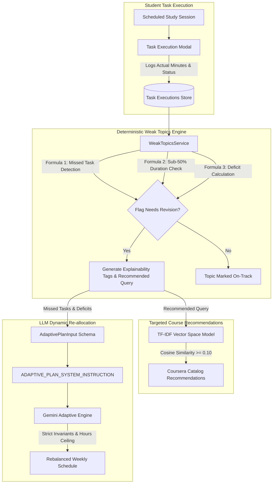

# System Architecture & Technical Specification
## Deterministic Diagnostic Engine & Adaptive Study Plan Re-balancing

---

### 1. Architectural Overview & Design Philosophy

The **Smart Learning Planner** operates on a hybrid architecture designed to maintain high educational reliability and zero hallucinations:
1. **Generative AI (Google Gemini 1.5/2.0 Flash)** is utilized exclusively where natural language synthesis, schedule contextualization, and semantic topic planning add high value.
2. **Deterministic Diagnostic Rules** are strictly employed for assessing student deficiencies and academic mastery. **No probabilistic AI claims or speculative hallucinations are permitted** when deciding whether a student is weak in a subject.
3. **Information Retrieval (TF-IDF & Cosine Similarity)** grounds all learning resource recommendations in verified course catalogs (Coursera).

This document details the mathematical formulations governing **Weak Topic Detection** and the strict schema specifications powering **Adaptive Plan Re-allocation**.



---

### 2. Deterministic Weak Topic Detection Engine

The diagnostic engine is implemented in [backend/services/weak_topics.py](file:///e:/FinalYear/backend/services/weak_topics.py). It processes the active study plan and task execution telemetry without making external LLM calls.

#### 2.1 Mathematical Definitions & Variables
For any study session $s \in S$ belonging to topic $T$ of subject $Sub$:
- $P(s) \in \mathbb{R}^+$: Planned study duration in minutes ($P(s) = \text{duration\_hours} \times 60$).
- $A(s) \in \mathbb{R}_{\ge 0}$: Actual study minutes logged by the student.
- $\text{status}(s) \in \{\text{'completed'}, \text{'partially\_completed'}, \text{'missed'}, \text{'in\_progress'}, \text{None}\}$: Task execution status.
- $\text{day\_idx}(s) \in \{1, 2, \dots, 7\}$: Scheduled day index (Monday = 1, Sunday = 7).
- $\text{current\_day\_idx} \in \{1, 2, \dots, 7\}$: Active reference day index.

For topic $T$ across all evaluated sessions $S_T$:
$$\text{PlannedMinutes}(T) = \sum_{s \in S_T} P(s)$$
$$\text{ActualMinutes}(T) = \sum_{s \in S_T} A(s)$$
$$\text{Deficit}(T) = \max\Big(0, \text{PlannedMinutes}(T) - \text{ActualMinutes}(T)\Big)$$
$$\text{DurationRatio}(T) = \frac{\text{ActualMinutes}(T)}{\max(1, \text{PlannedMinutes}(T))}$$

---

#### 2.2 Deterministic Decision Rules

A topic $T$ is flagged with `status = "Needs Revision"` if and only if one or more of the following deterministic conditions are satisfied:

##### Rule 1: Explicitly Missed Sessions Criterion
A session $s$ is evaluated as missed if:
$$\text{is\_missed}(s) = \begin{cases} 
\text{True}, & \text{if } \text{status}(s) = \text{'missed'} \\
\text{True}, & \text{if } \text{day\_idx}(s) < \text{current\_day\_idx} \land s \notin \text{completed\_ids} \land \text{status}(s) \notin \{\text{'completed'}, \text{'rebalanced'}\} \\
\text{False}, & \text{otherwise}
\end{cases}$$

If $\sum_{s \in S_T} \mathbb{I}(\text{is\_missed}(s)) > 0$:
- **Status**: `"Needs Revision"`
- **Severity**: `"high"`
- **Deterministic Tag**: `"Missed Task: {topic}"` (and `"{count} Missed Sessions"` if count $> 1$)

##### Rule 2: Sub-50% Study Duration Criterion
A session $s$ exhibits a sub-50% duration deficit if:
$$\text{is\_sub50}(s) = \left( \frac{A(s)}{P(s)} < 0.50 \right) \land \Big( P(s) - A(s) \ge 15\text{ mins} \Big)$$

If any session has $\text{is\_sub50}(s) = \text{True}$ or the topic aggregate $\text{DurationRatio}(T) < 0.50$:
- **Status**: `"Needs Revision"`
- **Deterministic Tag**: `"Sub-50% Study Duration ({int}(\text{DurationRatio} \times 100)\%)"`
- **Severity**: Elevated to at least `"medium"` (or `"high"` if deficit $\ge 60$ mins).

##### Rule 3: Quantifiable Deficit Thresholding
$$\text{Severity}(T) = \begin{cases}
\text{"high"}, & \text{if } \text{Deficit}(T) \ge 60\text{ mins} \lor \text{missed\_sessions} > 0 \\
\text{"medium"}, & \text{if } 15\text{ mins} \le \text{Deficit}(T) < 60\text{ mins} \lor \text{DurationRatio}(T) < 0.50 \\
\text{"low"}, & \text{otherwise}
\end{cases}$$

If $\text{Deficit}(T) \ge 15\text{ mins}$:
- **Deterministic Tag**: `"Study Deficit: -{\text{Deficit}(T)}m"`

##### Rule 4: Multi-Session Low Completion Rate
For topics with multiple planned sessions $|S_T| \ge 1$:
$$C(T) = \frac{\sum_{s \in S_T} \mathbb{I}(\text{is\_done}(s))}{|S_T|} \times 100$$
If $C(T) < 50\%$ and $\sum \mathbb{I}(\text{is\_done}(s)) < |S_T|$:
- **Deterministic Tag**: `"Completion Rate: {C(T)}\% (Low Mastery)"`

##### Rule 5: High Priority Exam Target Alignment
If $\exists s \in S_T$ such that $\text{priority}(s) = \text{"high"}$ and topic $T$ is flagged as `"Needs Revision"`:
- **Deterministic Tag**: `"High Priority Exam Target"`

##### Rule 6: Protection for Future Unattempted Sessions
To prevent false-positive deficits:
$$\forall s \in S : \Big(\text{day\_idx}(s) > \text{current\_day\_idx} \land \text{has\_no\_telemetry}(s)\Big) \implies \text{ignored from evaluation}$$

---

#### 2.3 Deterministic Priority Sorting
Flagged weak topics are sorted deterministically before delivery to the frontend or recommendation pipeline:
$$\text{Rank}(T) = \Big( \mathbb{I}(\text{missed\_sessions} > 0), \; \text{SeverityRank}(T), \; \text{Deficit}(T) \Big) \quad \text{descending}$$
where $\text{SeverityRank}(\text{'high'}) = 3, \; \text{SeverityRank}(\text{'medium'}) = 2, \; \text{SeverityRank}(\text{'low'}) = 1$.

---

### 3. Adaptive Prompt Schema & Dynamic Re-Allocation

When the user requests an adaptive re-balance or the system detects missed high-priority tasks, [backend/prompts/study_plan.py](file:///e:/FinalYear/backend/prompts/study_plan.py) constructs an adaptive prompt grounded in strict Pydantic schemas.

#### 3.1 Pydantic Input Schemas

##### `MissedTaskInput`
Defines an individual missed task with required deficit quantification:
```python
class MissedTaskInput(BaseModel):
    task_id: Optional[str] = Field(None, description="Unique identifier of the missed task")
    subject: str = Field(..., description="Subject name (exact string)")
    topic: str = Field(..., description="Topic name")
    priority: PriorityLevel = Field("high", description="Session priority ('high', 'medium', 'low')")
    missed_day: DayName = Field(..., description="Day on which session was scheduled and missed")
    planned_duration_hours: float = Field(..., ge=0.1, description="Original planned duration in hours")
    actual_minutes_studied: float = Field(0.0, ge=0.0, description="Actual minutes studied before dropping")
    deficit_hours: float = Field(..., ge=0.0, description="Net remaining hours needed to recover topic")
    reason: Optional[str] = Field("Missed study session", description="Audit reason for deficit")
```

##### `AdaptivePlanInput`
Defines the full payload provided to the adaptive AI planner:
```python
class AdaptivePlanInput(BaseModel):
    current_plan: StudyPlanOutputSchema = Field(
        ...,
        description="The active 7-day study plan to be dynamically rebalanced"
    )
    missed_tasks: List[MissedTaskInput] = Field(
        ...,
        description="List of missed study sessions, focusing on high-priority subjects"
    )
    current_day: DayName = Field(
        ...,
        description="Active day of the week. Re-allocation only targets this day and subsequent days."
    )
    daily_hours_limit: Optional[float] = Field(
        None,
        ge=0.5,
        le=16.0,
        description="Maximum available study hours per day to enforce non-overload invariant"
    )
    onboarding_data: Optional[OnboardingDataInput] = Field(
        None,
        description="Original student profile constraints"
    )
    adaptation_goal: Optional[str] = Field(
        "Dynamically re-allocate missed high-priority subjects into remaining days without exceeding daily study hours"
    )
```

---

#### 3.2 System Prompt Invariants (`ADAPTIVE_PLAN_SYSTEM_INSTRUCTION`)

The system prompt strictly binds Gemini to ten non-negotiable operational invariants:

| # | Invariant Rule | Operational Enforcement |
| :-: | :--- | :--- |
| **1** | **Mandatory High-Priority Recovery** | All missed tasks with `priority="high"` must be rescheduled into remaining days with `core_concept_study` or `practice_problems` and prefixed with `"Catch-up: "`. |
| **2** | **Forward-Only Allocation** | Rescheduling is strictly restricted to days $d \ge \text{current\_day}$. Historical days ($d < \text{current\_day}$) must remain unchanged. |
| **3** | **Strict Daily Hours Ceiling** | $\forall d : \sum_{s \in d} \text{duration\_hours}(s) \le \text{daily\_hours\_limit}$. If adding sessions causes overflow, the LLM must compress or defer `low` priority sessions. |
| **4** | **Cognitive Load Balancing** | No single day may contain $> 2.0$ consecutive hours of the same intensive technical subject. Catch-up work must be spread across days with lowest existing load. |
| **5** | **Zero-Hallucination Subject Fidelity** | Subject names must preserve 100% exact character strings from input profiles (e.g. `'BI-402'`, `'C++'`, `'AI/ML'`). |
| **6** | **Chronological Conflict-Free Timings** | Days must follow Monday $\to$ Sunday sequence. Within days, sessions must have valid, non-overlapping 24h `start_time` and `end_time` blocks. |
| **7** | **Optimized Search Keywords** | Output `search_keywords` array must be updated to include missed high-priority subjects + core skills to feed the TF-IDF Coursera recommendation service. |
| **8** | **Transparent Strategy Summary** | `strategy_summary` in `plan_overview` must explain exact reallocation actions and compression decisions. |
| **9** | **Strict Schema Compliance** | Output must adhere directly to `StudyPlanOutputSchema` without markdown wrappers. |
| **10** | **Recalculated Aggregates** | Day `total_hours` and weekly `weekly_total_hours` must match exact sums of active sessions. |

---

### 4. Integration with Targeted Recommendations

When [WeakTopicsService](file:///e:/FinalYear/backend/services/weak_topics.py) flags a weak topic, it automatically produces a normalized search query string:
$$\text{recommended\_query} = \text{Subject} \oplus \text{" "} \oplus \text{Topic}$$

This string is fed into [RecommendationService](file:///e:/FinalYear/backend/services/recommendation_service.py):
1. Transformed via fitted unigram `TfidfVectorizer(stop_words='english', max_features=5000)`.
2. Compared via **Cosine Similarity** against 3,522 Coursera course documents.
3. Pruned by cutoff threshold:
   $$\text{Filter: } \text{Sim}(\vec{q}, \vec{d}_i) \ge 0.10$$
4. Top 5 targeted refresher courses are rendered directly in the student's dashboard widget.

---

### 5. Verification Matrix & Test Coverage

The deterministic diagnostic rules and adaptive prompt schema are validated across the repository test suites:

| Component | Test Suite | Pass Rate | Validated Invariants |
| :--- | :--- | :---: | :--- |
| **Weak Topic Rules** | [test_weak_topics.py](file:///e:/FinalYear/backend/tests/test_weak_topics.py) | **6/6 (100%)** | Missed tasks, sub-50% duration threshold, future day protection, deterministic ordering |
| **Adaptive Schemas** | [test_study_plan_prompt.py](file:///e:/FinalYear/backend/tests/test_study_plan_prompt.py) | **30/30 (100%)** | Pydantic validation of `AdaptivePlanInput`, `MissedTaskInput`, prompt construction |
| **AI Anti-Hallucination** | [run_prompt_isolation_tests.py](file:///e:/FinalYear/backend/tests/run_prompt_isolation_tests.py) | **12/12 (100%)** | Subject fidelity across obscure electives, chronological timings, keywords mapping |
| **Full Lifecycle Flow** | [test_e2e_flow.py](file:///e:/FinalYear/backend/tests/test_e2e_flow.py) | **5/5 (100%)** | Plan $\to$ Miss Task $\to$ Deterministic Weak Topic Flag $\to$ Targeted Recs $\to$ Re-balance |
