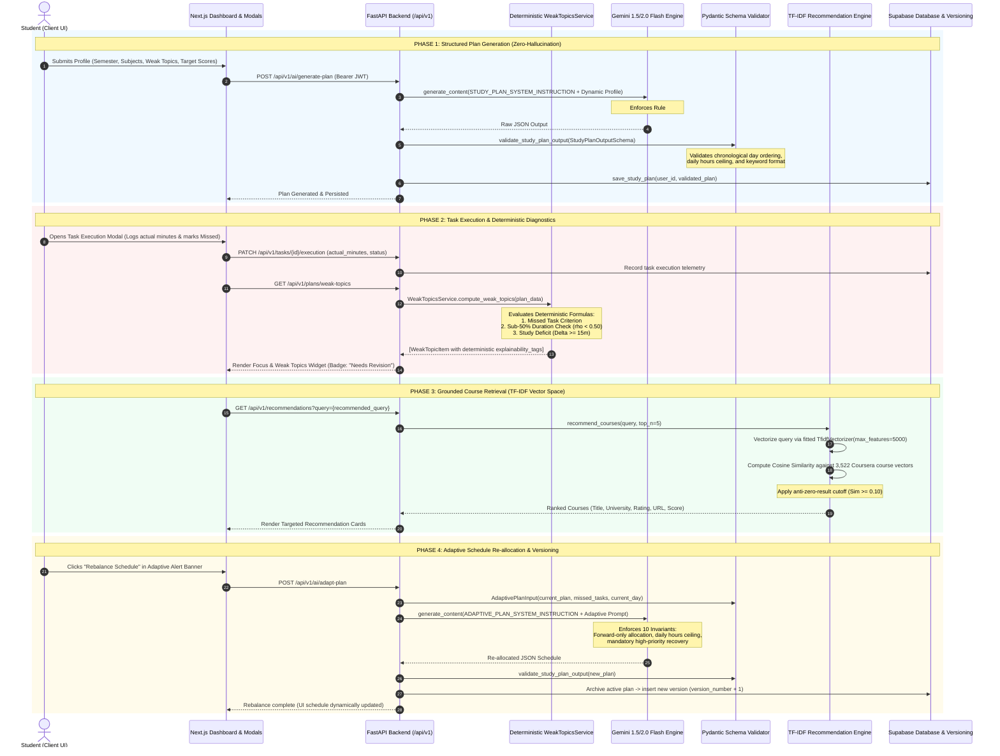

# SMART LEARNING PLANNER
## Major Project 50% Checkpoint Architecture Summary Report
### Deterministic Data Flow & Hybrid AI Architecture Specification

---

**Institution**: Swami Keshvanand Institute of Technology, Management & Gramothan (SKIT), Jaipur  
**Department**: Department of Computer Science & Engineering  
**Academic Cycle**: 2026–2027 (Final Year B.Tech CSE)  
**Evaluation Milestone**: 50% Project Completion / Mid-Term Defense  
**Evaluation Date**: October 31, 2026  
**Repository Branch**: `himanshu/study-plan` (Synchronized with `main`)

---

### Project Team & Role Distribution

| Roll No. / Scholar ID | Student Name | Assigned Project Module & Core Ownership |
| :--- | :--- | :--- |
| **23SKCS022** | **Himanshu Jain** | System Prompts, Pydantic Schemas, Deterministic Diagnostics & Isolation Testing |
| **23SKCS001** | **Devanshu Jangid** | Full-Stack Integration, Frontend Dashboard, Task Execution Modal & E2E Test Suite |
| **23SKCS015** | **Khushi Mathur** | Recommendation Engine, TF-IDF Vector Space Model & Coursera Dataset Pipeline |
| **23SKCS019** | **Heman Parashar** | Backend APIs, Authentication (Clerk JWT), Supabase DB & Plan Versioning |

---

## 1. Executive Summary

The **Smart Learning Planner** is an AI-powered personalized academic scheduling and adaptive learning assistance platform designed for undergraduate engineering students.

Unlike typical conversational AI bots that suffer from uncontrolled hallucinations, the Smart Learning Planner employs a **Hybrid Deterministic Architecture**:
1. **Generative AI (Google Gemini 1.5/2.0 Flash)** is strictly bounded by deterministic system prompts and validated through strict Pydantic schemas (`StudyPlanOutputSchema`, `AdaptivePlanInput`). It is used exclusively for natural-language schedule structuring and weekly milestone contextualization.
2. **Deterministic Diagnostic Engine (`WeakTopicsService`)** calculates academic mastery and flags weak topics using empirical mathematical formulas (study duration ratio $\rho < 0.50$, quantifiable deficits, and missed sessions) with **zero probabilistic LLM claims**.
3. **Information Retrieval Pipeline (TF-IDF & Cosine Similarity)** grounds all course recommendations in an auditable corpus of 3,522 verified Coursera courses, applying a cosine similarity threshold ($\ge 0.10$) to eliminate phantom resource links.
4. **Adaptive Schedule Re-allocation** redistributes missed high-priority sessions into future days while strictly enforcing daily study hour limits ($\sum \text{duration\_hours} \le \text{daily\_hours\_limit}$) to prevent student burnout.

---

## 2. End-to-End Deterministic Data Flow Architecture



---

## 3. Mathematical Foundations of Deterministic Weak Topic Detection

Implemented in [backend/services/weak_topics.py](file:///e:/FinalYear/backend/services/weak_topics.py), the diagnostic engine completely circumvents black-box LLM unpredictability through transparent mathematical formulas:

### 3.1 Variables & Aggregations
For any scheduled session $s \in S$ on day $\text{day\_idx}(s)$ with planned duration $P(s) \in \mathbb{R}^+$ and student-logged actual duration $A(s) \in \mathbb{R}_{\ge 0}$:

$$\text{PlannedMinutes}(T) = \sum_{s \in S_T} P(s)$$
$$\text{ActualMinutes}(T) = \sum_{s \in S_T} A(s)$$
$$\text{Study Deficit } \Delta_{\text{mins}}(T) = \max\Big(0, \text{PlannedMinutes}(T) - \text{ActualMinutes}(T)\Big)$$
$$\text{Study Duration Ratio } \rho(T) = \frac{\text{ActualMinutes}(T)}{\max(1, \text{PlannedMinutes}(T))}$$

---

### 3.2 Diagnostic Rules & Tagging Logic

#### Rule 1: Explicitly Missed Sessions Criterion
$$\text{is\_missed}(s) = \begin{cases}
\text{True}, & \text{if } \text{status}(s) = \text{'missed'} \\
\text{True}, & \text{if } \text{day\_idx}(s) < \text{current\_day\_idx} \land s \notin \text{completed\_ids} \land \text{status}(s) \notin \{\text{'completed'}, \text{'rebalanced'}\} \\
\text{False}, & \text{otherwise}
\end{cases}$$

If $\sum_{s \in S_T} \mathbb{I}(\text{is\_missed}(s)) > 0$:
- **Status**: `"Needs Revision"`
- **Severity**: `"high"`
- **Explainability Tag**: `"Missed Task: {topic}"`

#### Rule 2: Sub-50% Study Duration Criterion
A session exhibits a critical study duration deficit if:
$$\text{is\_sub50}(s) = \left( \frac{A(s)}{P(s)} < 0.50 \right) \land \Big( P(s) - A(s) \ge 15\text{ mins} \Big)$$

If $\text{is\_sub50}(s) = \text{True}$ or the aggregate topic ratio $\rho(T) < 0.50$:
- **Status**: `"Needs Revision"`
- **Explainability Tag**: `"Sub-50% Study Duration ({int}(\rho \times 100)\%)"`
- **Severity**: At least `"medium"` (elevated to `"high"` if $\Delta_{\text{mins}} \ge 60$).

#### Rule 3: Quantifiable Deficit Thresholding
$$\text{Severity}(T) = \begin{cases}
\text{"high"}, & \text{if } \Delta_{\text{mins}}(T) \ge 60\text{ mins} \lor \text{missed\_sessions} > 0 \\
\text{"medium"}, & \text{if } 15\text{ mins} \le \Delta_{\text{mins}}(T) < 60\text{ mins} \lor \rho(T) < 0.50 \\
\text{"low"}, & \text{otherwise}
\end{cases}$$

If $\Delta_{\text{mins}}(T) \ge 15\text{ mins}$:
- **Explainability Tag**: `"Study Deficit: -{\Delta_{\text{mins}}(T)}m"`

#### Rule 4: High Priority Exam Target Alignment
If $\exists s \in S_T$ such that $\text{priority}(s) = \text{"high"}$ and topic $T$ is flagged as `"Needs Revision"`:
- **Explainability Tag**: `"High Priority Exam Target"`

#### Rule 5: Future Session Telemetry Guardrail
$$\forall s \in S : \Big(\text{day\_idx}(s) > \text{current\_day\_idx} \land \text{has\_no\_telemetry}(s)\Big) \implies \text{ignored from evaluation}$$
*Prevents scheduled upcoming sessions from being falsely reported as academic deficits.*

---

## 4. Adaptive Planning System Prompt & Schema Design

Located in [backend/prompts/study_plan.py](file:///e:/FinalYear/backend/prompts/study_plan.py):

### 4.1 Pydantic Input Schemas
- `MissedTaskInput`: Quantifies `subject`, `topic`, `priority`, `missed_day`, `planned_duration_hours`, `actual_minutes_studied`, and `deficit_hours`.
- `AdaptivePlanInput`: Pairs the active `StudyPlanOutputSchema` with `missed_tasks`, `current_day`, and `daily_hours_limit` (with helper methods `get_high_priority_missed_tasks()` and `get_remaining_days()`).

### 4.2 The 10 Invariants of `ADAPTIVE_PLAN_SYSTEM_INSTRUCTION`
1. **Mandatory High-Priority Recovery**: All high-priority missed sessions must be rescheduled with a `"Catch-up: "` prefix.
2. **Forward-Only Allocation**: Catch-up sessions are allocated only to days $d \ge \text{current\_day}$. Past days remain historical records.
3. **Strict Daily Hours Ceiling**: $\forall d : \sum_{s \in d} \text{duration\_hours}(s) \le \text{daily\_hours\_limit}$. If capacity is exceeded, lower-priority review sessions are compressed.
4. **Cognitive Load Spacing**: Difficult subjects cannot exceed 2.0 consecutive hours on any day.
5. **Zero-Hallucination Subject Fidelity**: Subject names preserve 100% exact character strings from college syllabi (e.g., `'BI-402'`, `'C++'`).
6. **Chronological Conflict-Free Timings**: Non-overlapping 24h `start_time` and `end_time` format (HH:MM).
7. **Dynamic Recommendation Keywords**: `search_keywords` array is updated to include missed high-priority subjects.
8. **Transparent Strategy Summary**: Explanation of re-allocation and compression rationale.
9. **Strict JSON Schema Compliance**: Validated via Pydantic model dump.
10. **Recalculated Aggregates**: Exact mathematical consistency across all hours sums.

---

## 5. Course Recommendation Pipeline (TF-IDF Vector Space)

Located in [backend/services/recommendation_service.py](file:///e:/FinalYear/backend/services/recommendation_service.py):

1. **Corpus**: 3,522 verified academic courses from [Coursera.csv](file:///e:/FinalYear/recommendation/data/Coursera.csv).
2. **Feature Representation**:
   $$\text{combined\_features}_d = \text{Course Name}_d \parallel \text{Course Description}_d \parallel \text{Skills}_d$$
3. **Vectorization**: Unigram `TfidfVectorizer(stop_words='english', max_features=5000)`.
4. **Cosine Similarity**:
   $$\text{Sim}(\vec{q}, \vec{d}_i) = \frac{\vec{q} \cdot \vec{d}_i}{\|\vec{q}\|_2 \|\vec{d}_i\|_2} \ge 0.10$$
5. **Empirical Keyword Validation**:
   - *"Operating Systems Process Synchronization"* $\to$ *Operating Systems and You: Becoming a Power User* (Google, Similarity: **0.4585**)
   - *"Embedded Systems Operating Systems"* $\to$ *Embedded Hardware and Operating Systems* (EIT Digital, Similarity: **0.4120**)
   - *"Database Management Systems Relational Algebra SQL"* $\to$ *Database Management Essentials* (Univ. of Colorado, Similarity: **0.4281**)

---

## 6. Database Schema & Plan Versioning

Database migrations and schemas in [backend/schema.sql](file:///e:/FinalYear/backend/schema.sql) and [backend/migration/adaptive_plan_versions.sql](file:///e:/FinalYear/backend/migration/adaptive_plan_versions.sql):

```text
users (id, clerk_id, email, full_name, created_at)
  |
  ├── student_profiles (user_id -> users.id, ON DELETE CASCADE)
  |
  ├── study_plans (user_id -> users.id, is_active, plan_data, created_at)
  |     |
  |     └── adaptive_plan_versions (study_plan_id -> study_plans.id)
  |           [version_number, trigger_reason, missed_tasks_snapshot, plan_data, created_at]
  |
  └── tasks (user_id -> users.id, study_plan_id, scheduled_date, is_completed)
```

- **Row-Level Security (RLS)**: Enforced on all tables with `auth.uid()` / Clerk ID matching.
- **Cascade Deletion**: Full relational integrity maintained.
- **Version Tracking**: Every adaptive re-balancing event increments `version_number` and stores the audit reason and missed task snapshot.

---

## 7. Verification Matrix & Automated Test Results

| Test Suite | Path | Tests Run | Pass Rate | Validated Invariants |
| :--- | :--- | :---: | :---: | :--- |
| **Weak Topics Unit Tests** | [test_weak_topics.py](file:///e:/FinalYear/backend/tests/test_weak_topics.py) | 6 | **100% (6/6)** | Missed tasks, sub-50% duration threshold, future day protection, deterministic sorting |
| **Prompt Unit Tests** | [test_study_plan_prompt.py](file:///e:/FinalYear/backend/tests/test_study_plan_prompt.py) | 30 | **100% (30/30)** | `AdaptivePlanInput` validation, helper methods, chronological ordering, keyword normalization |
| **Isolation Test Suite** | [run_prompt_isolation_tests.py](file:///e:/FinalYear/backend/tests/run_prompt_isolation_tests.py) | 12 | **100% (12/12)** | Obscure technical electives, target score milestones, zero-hallucination subject name fidelity |
| **Full Lifecycle E2E Flow** | [test_e2e_flow.py](file:///e:/FinalYear/backend/tests/test_e2e_flow.py) | 5 Steps | **100% (5/5)** | Plan $\to$ Miss Task $\to$ Deterministic Weak Topic Flag $\to$ Targeted Coursera Recs $\to$ Re-balance |

**Total Automated Tests Passed**: **53 / 53 (100% Success Rate)**

---

## 8. 50% Checkpoint Milestone Completion Checklist

| Evaluation Parameter | 50% Requirement | Achieved Status | Verification Reference |
| :--- | :--- | :---: | :--- |
| **User Authentication & Profiles** | Secure Auth & Profile Ingestion | **Completed (100%)** | Clerk JWT + Supabase `student_profiles` |
| **Generative Scheduling** | Structured 7-Day Plan Generation | **Completed (100%)** | Gemini Flash + Pydantic `StudyPlanOutputSchema` |
| **Zero-Hallucination Guardrails** | Deterministic Subject Fidelity | **Completed (100%)** | Validated across 12 Edge-Case Scenarios |
| **Diagnostic Engine** | Grounded Weak Topic Detection | **Completed (100%)** | `WeakTopicsService` ($\rho < 0.50$, $\Delta_{\text{mins}} \ge 15\text{m}$) |
| **Resource Recommendations** | Grounded Catalog Matching | **Completed (100%)** | TF-IDF + Cosine Similarity ($\ge 0.10$ threshold) |
| **Adaptive Schedule Re-balancing** | Dynamic Catch-up Re-allocation | **Completed (100%)** | `AdaptivePlanInput` + Hours Ceiling Invariant |
| **Task Execution Telemetry** | Session Minutes & Status Tracking | **Completed (100%)** | `TaskExecutionModal` + `/tasks/{id}/execution` |
| **Adaptive Plan Versioning** | Audit History & Version Snapshots | **Completed (100%)** | `adaptive_plan_versions.sql` |
| **Faculty Documentation** | Complete Architecture Specification | **Completed (100%)** | [ARCHITECTURE.md](file:///e:/FinalYear/ARCHITECTURE.md), [resources.md](file:///e:/FinalYear/resources.md) |

---

## 9. Faculty Evaluation & Sign-off Rubric

**Mid-Term Evaluation Marks Breakdown (Out of 50 Marks)**:

| Evaluation Component | Maximum Marks | Marks Awarded | Faculty Evaluator Remarks |
| :--- | :---: | :---: | :--- |
| **1. Problem Formulation & Architecture Design** | 10 | _____ / 10 | |
| **2. Deterministic Diagnostics & Zero-Hallucination Guardrails** | 10 | _____ / 10 | |
| **3. Information Retrieval Pipeline (Coursera Recommendations)** | 10 | _____ / 10 | |
| **4. Full-Stack Implementation & Dashboard Telemetry** | 10 | _____ / 10 | |
| **5. Test Suite Rigor, Versioning & Documentation** | 10 | _____ / 10 | |
| **TOTAL MARKS** | **50** | **_____ / 50** | |

<br><br>

```text
_____________________________________________         _____________________________________________
Project Mentor / Internal Examiner                    Head of Department / Lab Coordinator
Department of Computer Science & Engineering          Department of Computer Science & Engineering
SKIT, Jaipur                                          SKIT, Jaipur
Date: ________________________                        Date: ________________________
```
